# Negative Horror Photo Lab

*An unstable darkroom for ghosts and hauntologists.*

This is a darkroom simulator for antiquated, lo-fi photographic processes. It is not a filter. You place
transparencies and objects in a light path, set up a lamp and an aperture, expose a plate on a real-time
clock while shading it with your hand, watch it come up in the developer, and pull it when it looks right.
Mistakes are part of the process: uneven pours, bromide drag, light leaks, reciprocity failure, flashing
the light mid-development, under-fixing, dropping the plate, and decades of ageing.

**All output is black-and-white or sepia. The program never produces colour.** See
[Monochrome guarantee](#monochrome-guarantee).

### Demos

Every process with its default settings, run on one photo:

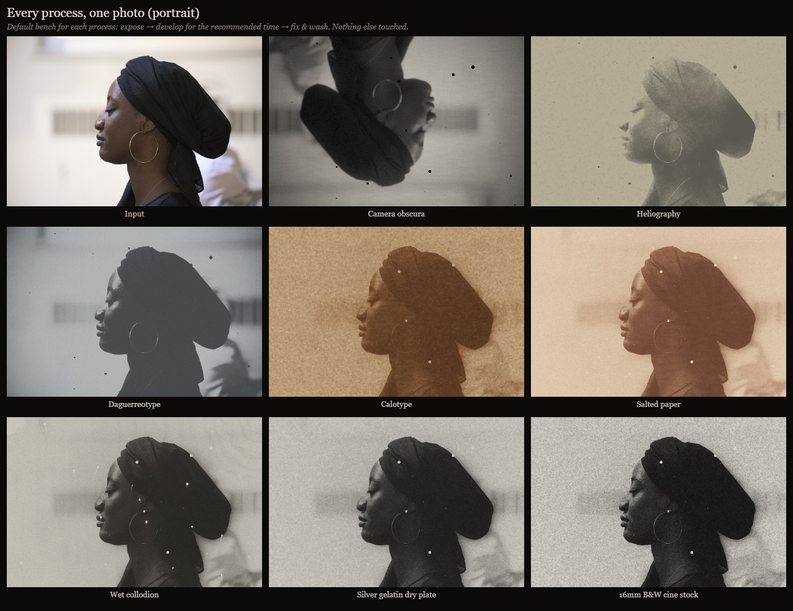

<details>
<summary><strong>More demos</strong> (exposure, optics, chemistry, accidents, ghosts…)</summary>

**Every process, on other photos**

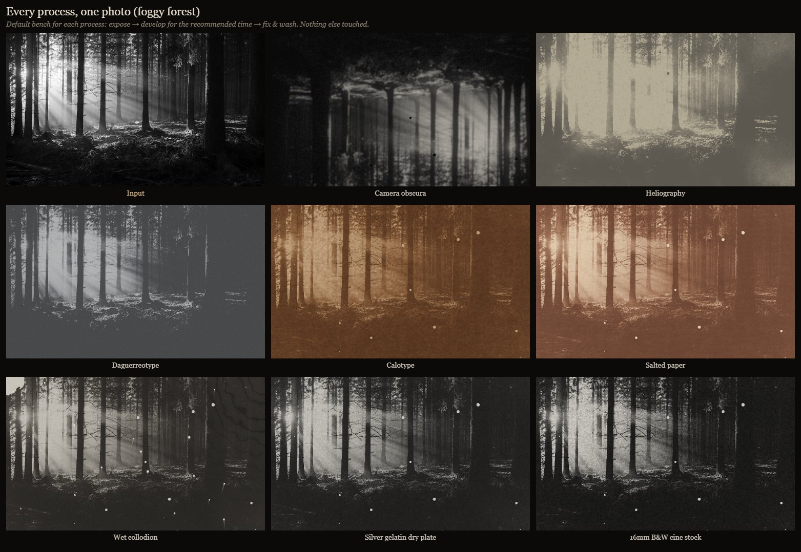
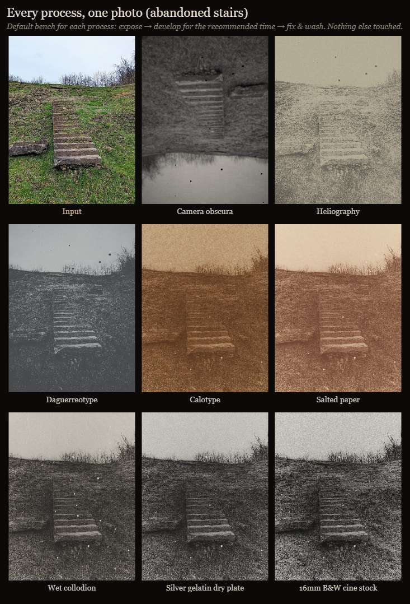
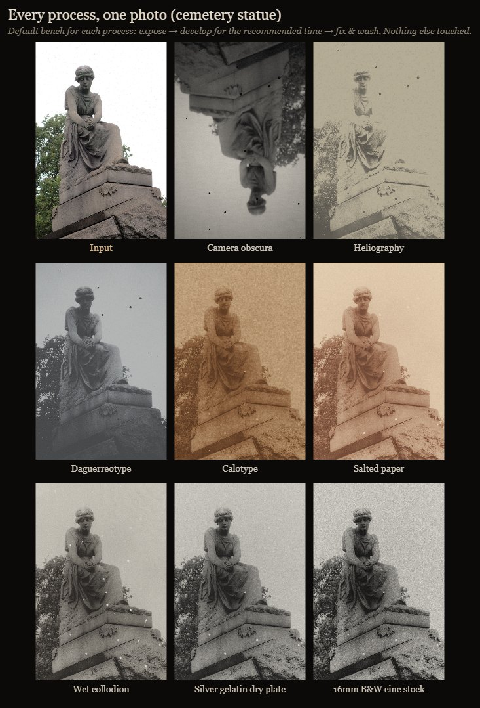

**Exposure and emulsion**

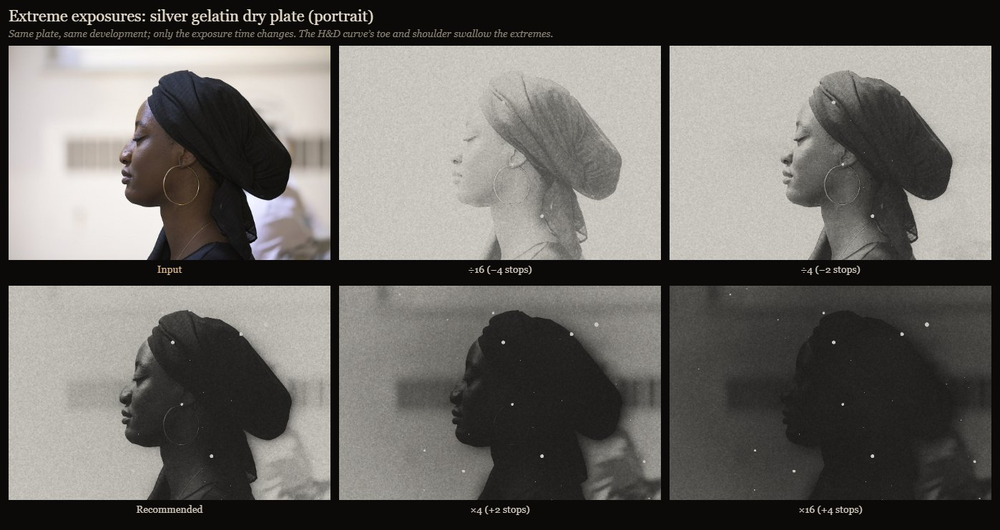
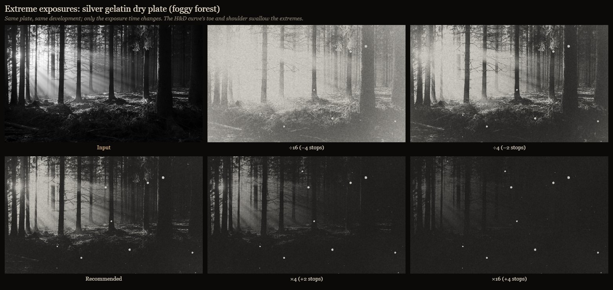
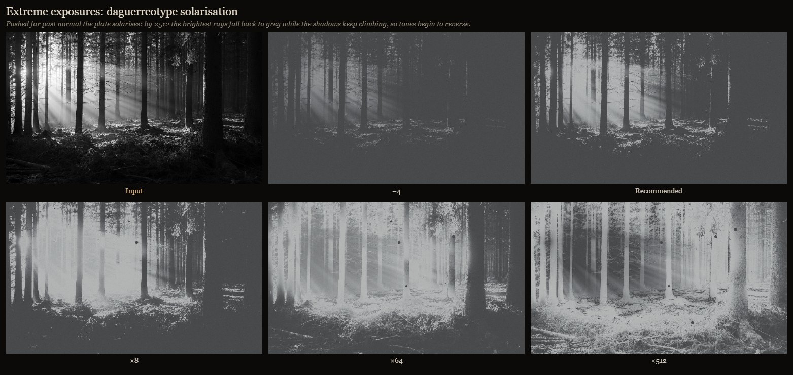
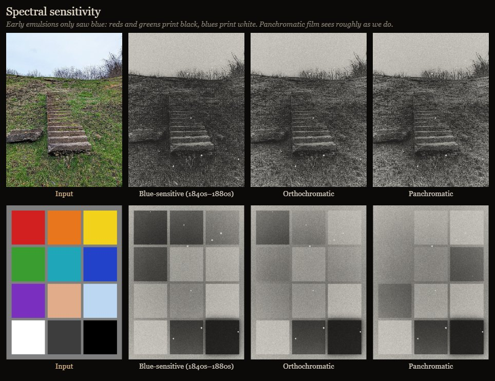
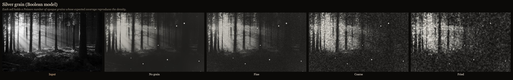
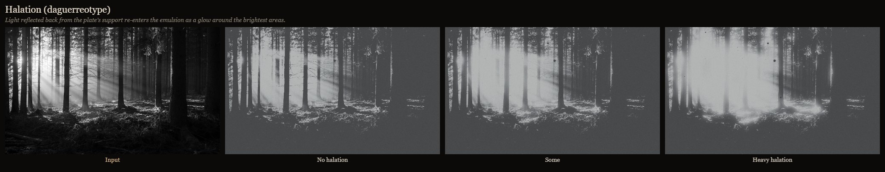

**Light path and optics**

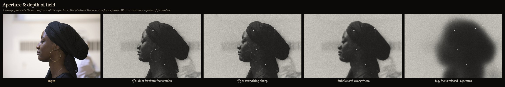
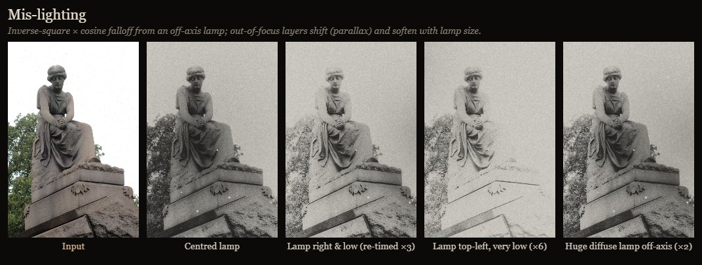
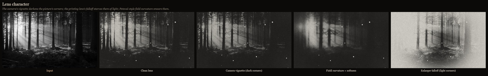
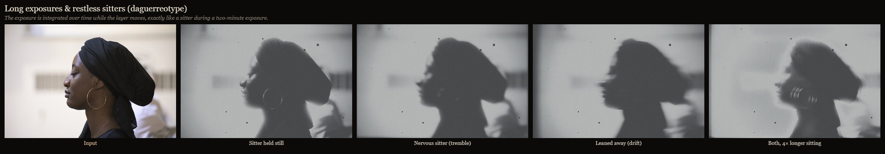
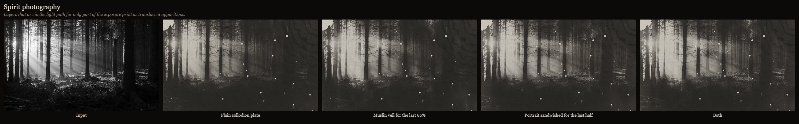
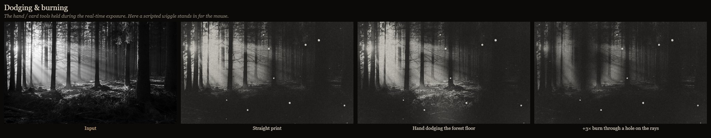

**Darkroom chemistry**

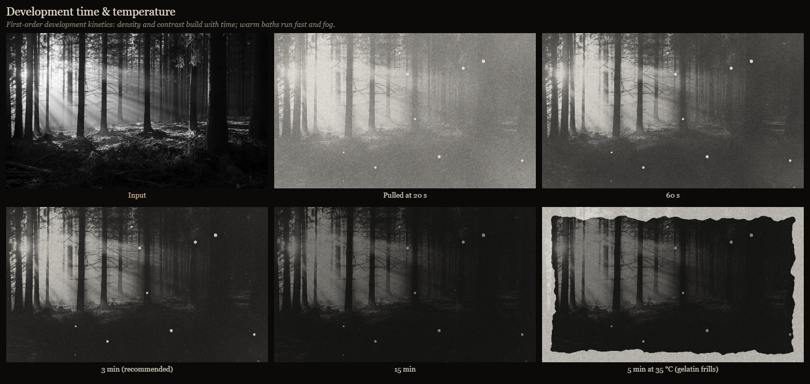
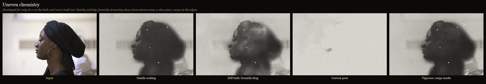
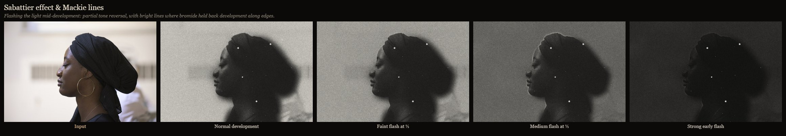
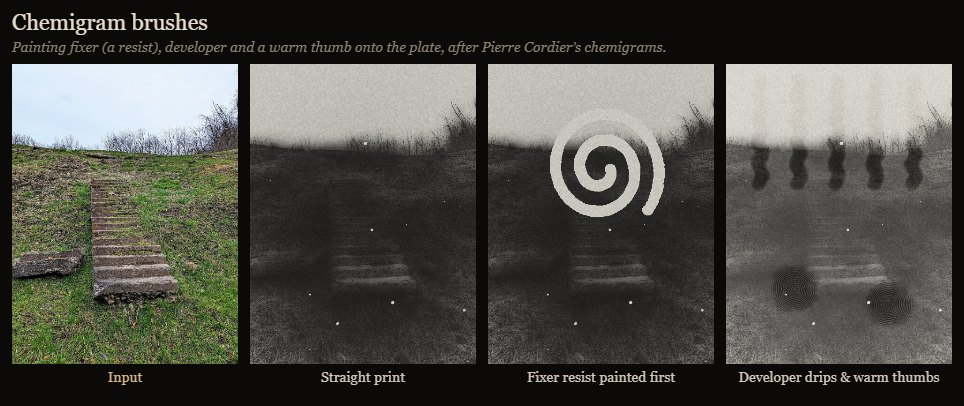
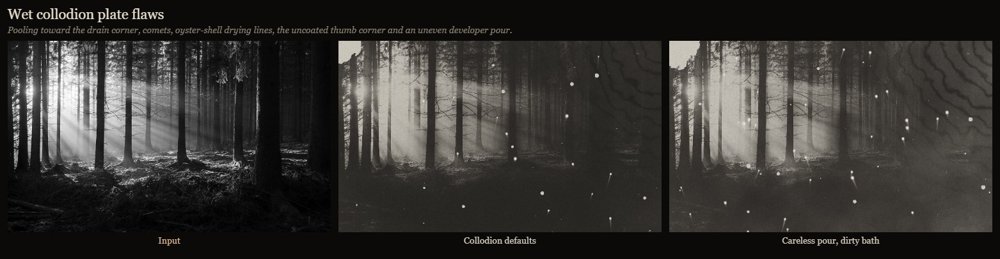
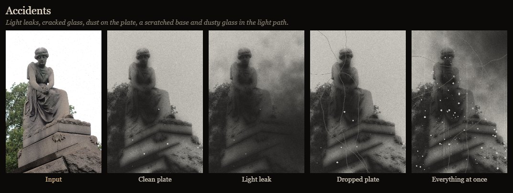

</details>

The demos are generated by driving the app headlessly with seeded randomness. To regenerate them, run
`npm install` and then `npm run demos` (needs Edge or Chrome).

---

## Running it

There are no dependencies and no build step. Open `index.html` in Chrome, Edge or Firefox.
Double-clicking the file is enough, because the scripts are plain classic scripts and not ES modules.

Or, from a terminal in the project folder:

```sh
npm start
```

This opens `index.html` in your default browser (no `npm install` needed).

A demo transparency (a procedurally drawn corridor and figure) is loaded at start so you can try the bench
right away. Loading your own photo or video in section **1 · Load your picture** removes the demo.

**New here? Read the [Quick Start Guide](QUICKSTART.md).** It walks through photos and video step by step,
and has a "how do I get this look" table. In the app, the **NEXT** box under the plate always tells you
which button to press, and that button pulses.

## How a plate is made

The UI sections are numbered in workflow order. Sections 3–5 and 9 are optional and start collapsed.
The **View** menu above the plate switches between the plate, the **original photo** (placed exactly as
it lands on the plate, with other layers ghosted on top), a **split** wipe comparing the two, and the
**projection**. **Original ⇄ Plate** flips between the plate and the original, and holding **O** peeks
at the original. The original is shown in its true colours as a reference only. *Save PNG* and *Use plate
as layer* always use the plate.

1. **Load your picture.** Load a positive photo or a negative scan. The section also lists everything
   in the light path (the layers), and has *Add an object* and an *Adjust selected layer* panel.
   Every layer sits a set number of millimetres in front of the aperture. Each layer is blurred by its
   defocus from the focus plane, and all layers multiply together. A layer has a position, scale,
   rotation, opacity, a time window (when it enters and leaves the light path), drift (movement across
   the exposure) and tremble (random shaking). Layer types:
   * **Transparency**: your picture, either a positive photo or a negative scan. With *Correct polarity*
     on, it is copied through an internegative or interpositive so the result reads the right way round.
     With it off, the transmittance is used raw.
   * **Dusty glass**, **Scratched film base**, **Muslin veil** (spirit "ectoplasm"), **Oval mat**.
   * **Paintable card**: draw your own mask with the *Paint card* tool. Shift-drag cuts it away.
2. **Choose a process.** This sets the emulsion's spectral sensitivity, speed, contrast, reciprocity
   behaviour, developer, support and native tone. It also holds the plate size, the contrast grade, and
   *Fresh plate*.
3. **Lamp** *(optional)*. Set intensity, position (off-axis lamps give uneven light and shift
   out-of-focus layers), height, size (diffuse vs point), condenser (Callier effect), flicker, and travel
   (the sun moving across the sky during a long exposure).
4. **Aperture & lens** *(optional)*. Choose a round iris, pinhole, or horizontal/vertical slit. Then set
   the f-number, the focus distance, lens softness, field curvature, cos⁴ vignetting and image inversion.
5. **Plate flaws & grain** *(optional)*. Grain, coating unevenness, pour pooling, the uncoated thumb
   corner, dust, paper fibres, comets, oyster-shell lines, buff lines and frilling.
6. **Expose.** *Uncap lens* runs the exposure on the darkroom clock. While it runs, hold the mouse on the
   plate with the **Hand** tool to dodge, or the **Card with hole** tool to burn. *Instant exposure* runs
   the whole exposure without interaction. You can expose several times on one plate. This section also
   has a *Test strip* button and an accidental *Light leak* button.
7. **Develop & fix.** *Into the tray* (or *Over the mercury*, or *Into the solvent*, depending on the
   process) lets you watch the image emerge, then *Pull* it. Temperature, agitation, uneven chemistry,
   uneven pour and bromide drag all change the result. *Flash light* during development produces the
   Sabattier effect with Mackie lines. The chemistry brushes (developer, fixer resist, water, warm thumb)
   can be used before or during development, which makes chemigram-style work possible. *Fix & wash*
   finishes the plate; short fix or wash times leave residues that darken and stain with age.
8. **Tone, age & save.** Toners are sepia (affects highlights first), selenium (affects shadows first)
   and gold. The *Years* slider adds fading, foxing, silvering-out, tarnish halos and frilling. The
   daguerreotype *Surroundings* slider turns the mirror plate from positive to negative.
   *Drop the plate* cracks glass. *Use plate as layer* turns the finished plate into a transparency for
   the next print, which is how you do calotype → salt print, or repeat re-photography by hand.
   *Save PNG* downloads the plate.
9. **Video reel** *(optional)*. See [The reel](#the-reel-video).
Recipes in the header (Spirit photograph, Window at Le Gras, Restless sitter, Calotype → salt print,
Sabattier nightmare, Begotten-style reel) only **set up the bench**. They never expose or develop for you.

## Processes

| Process | Polarity / development | Notes |
|---|---|---|
| Camera obscura | projection, no chemistry | Pinhole, inverted image. The image exists only while the light does. |
| Heliography (Niépce) | bitumen hardens in light; solvent wash | Exposures of hours. Sun travel enabled. Over-washing erodes the image. |
| Daguerreotype | direct positive; mercury fuming | Blue-sensitive. Solarises. Mirror plate reads positive or negative depending on surroundings. Tarnish halo. |
| Calotype (Talbot) | paper negative; gallo-nitrate | Paper fibres print through. |
| Salted paper | printing-out (no developer) | The image forms visibly during exposure. Fades and yellows badly. |
| Wet collodion (Scott Archer) | poured glass negative; iron developer | Pour pooling, comets, oyster-shell drying lines, uncoated thumb corner. |
| Silver gelatin dry plate | factory glass negative; tray developer | Silvering-out and frilling with age. |
| 16mm B&W cine stock | contrasty panchromatic | Meant for the reel. |

## The reel (video)

Section **9 · Video reel** prints every frame of a video through the current bench: the same layers, lamp,
aperture, plate and chemistry. The frame replaces whichever transparency is marked *Reel source*.
On top of that it adds film-transport instabilities:

* gate weave, as a random walk of the frame offset
* exposure flicker
* persistent wandering scratches
* dust and hairs
* frame-line slip
* step printing, where each frame is repeated N times
* developer exhaustion along the reel
* **generations**: each frame is re-photographed from its own print N times, so contrast, grain and dirt
  build up the way they do on an optical printer

*Develop reel* renders the frames, *Project* plays them back, and *Project & record* exports a `.webm`
through the browser's `MediaRecorder`.

---

## Algorithms and the physics they approximate

These are artistic approximations of real phenomena, chosen to stay controllable by hand. They are not
metrology-grade models. Where a number is tuned rather than measured, the code says so.

| Phenomenon | Implementation | File |
|---|---|---|
| Spectral sensitivity (blue-sensitive, orthochromatic, panchromatic) | Per-process RGB weights applied to linearised sRGB before conversion to transmittance | `optics.js`, `processes.js` |
| Internegative / interpositive | Negative density ∝ γ·log(scene luminance), with γ = 0.7 | `optics.js` |
| Callier effect | Silver transmittance raised to Q ∈ [1, 1.45] for condenser light | `optics.js` |
| Defocus of layers | Gaussian σ ∝ \|distance − focus\| / f-number. Pinhole blur is independent of distance. Slits are anisotropic | `optics.js` |
| Penumbra from lamp size | Extra σ ∝ defocus × lamp size | `optics.js` |
| Uneven / off-axis illumination | Inverse-square × Lambert cosine: E ∝ (h/d)³ | `optics.js` |
| Natural vignetting | cos⁴ law | `optics.js` |
| Off-axis parallax | Defocused layers shift in proportion to lamp offset × defocus | `optics.js` |
| Motion, tremble, multiple exposures | Exposure integrated over sub-steps, with layers entering and leaving the light path | `optics.js` |
| Dodging / burning | Soft-edged occluder applied per clock tick while the mouse is held | `optics.js` |
| Field curvature | Radially weighted blend with a blurred exposure (a linear operation, applied after integration) | `emulsion.js` |
| Halation | Highlights scattered at two radii and added back | `emulsion.js` |
| Reciprocity failure | Schwarzschild law: effective exposure ∝ I·t^p beyond a reference time | `emulsion.js` |
| Characteristic curve | Logistic H&D curve in log exposure, with slope γ at the speed point and optional solarisation roll-over | `emulsion.js` |
| Development kinetics | Per-pixel first-order growth, D = D∞·(1 − e^(−k·t)), with k scaled by temperature (Q10 ≈ 2), agitation and local activity | `emulsion.js` |
| Uneven chemistry, pour delay, surge marks, mercury-cup gradient | fBm activity maps, time-delay maps and edge terms | `emulsion.js` |
| Bromide drag | Downward exponential smear of developed density reduces local activity (suppressed by agitation) | `emulsion.js` |
| Sabattier effect and Mackie lines | Mid-development uniform flash attenuated by the silver already formed. A blurred-density inhibitor suppresses second development beside edges | `emulsion.js` |
| Heliographic solvent wash | Hardness threshold that rises with wash time | `emulsion.js` |
| Daguerreotype viewing | Amalgam scatter + mirror reflection of the surroundings | `render.js` |
| Silver grain | Boolean-model grain: per-cell Poisson grain count whose expected coverage reproduces the local density, at two clump scales | `artifacts.js` |
| Coating, pooling, thumb corner, comets, oyster shell, frilling, buff lines, paper fibres | Procedural noise and geometry on the sensitivity map or the developed image | `artifacts.js` |
| Ageing | Fading, residual-hypo staining, print-out darkening of unfixed silver, foxing, silvering-out near edges, banded tarnish halo, glass cracks | `artifacts.js`, `render.js` |
| Toning | Native process palette blended with sepia, selenium or gold, using tone-dependent weights | `render.js` |
| Gaussian blur | Three cascaded box filters | `core.js` |
| Noise | Seeded value-noise fBm; mulberry32 PRNG; integer hash | `core.js` |

### Monochrome guarantee

Every pixel passes through `enforceMonochrome()` in [`js/render.js`](js/render.js). It caps each channel's
deviation from luminance at **0.16**, which is enough for sepia, selenium and gold tones but not for any
real colour. The *Projection* (focusing) view is pure grey. The automated check run during development
measured the maximum deviation over every process, toner, stain and foxing combination at 0.163, which is
the ceiling plus 8-bit rounding.

---

## Project layout

```
index.html          the bench
css/style.css       darkroom styling
js/core.js          RNG, noise, blur, sampling, image IO
js/processes.js     historical process parameters
js/optics.js        layers, lamp, aperture, exposure engine
js/emulsion.js      reciprocity, H&D curve, development, Sabattier, chemistry brush
js/artifacts.js     plate defects, grain, ageing maps, cracks
js/render.js        reflectance, toning, monochrome guarantee
js/video.js         reel printing, transport damage, projection and recording
js/app.js           UI, clock, tools, recipes
```

---

## Contributions and credits

* **Code**: written from scratch for this project. No third-party libraries, code or image assets are
  used. The demo scene is drawn procedurally at runtime.
* **Your material**: images and videos you load stay in your browser. Nothing is uploaded anywhere.

## Sources and references

### Historical processes
* Nicéphore Niépce, *View from the Window at Le Gras*, heliograph, c. 1826–27. Harry Ransom Center,
  University of Texas at Austin. <https://www.hrc.utexas.edu/niepce-heliograph/>
* L. J. M. Daguerre, *Historique et description des procédés du daguerréotype et du diorama*, Paris, 1839.
* W. H. Fox Talbot, calotype process, British patent no. 8842 (1841); *The Pencil of Nature* (1844–46).
* Frederick Scott Archer, "On the use of collodion in photography," *The Chemist*, March 1851.
* Richard Leach Maddox, "An experiment with gelatino-bromide," *British Journal of Photography*, 8 September 1871.
* Image Permanence Institute, *Graphics Atlas*: identification and deterioration of photographic processes
  (silvering-out, foxing, tarnish, frilling, salt print fading). <http://www.graphicsatlas.org/>
* Mike Ware, *Mechanisms of Image Deterioration in Early Photographs*, Science Museum / National Museum
  of Photography, Film & Television, 1994.
* Library of Congress, *Daguerreotypes* collection notes on viewing the mirror image as positive or
  negative. <https://www.loc.gov/collections/daguerreotypes/>

### Photographic science
* F. Hurter and V. C. Driffield, "Photo-chemical investigations and a new method of determination of
  the sensitiveness of photographic plates," *J. Soc. Chem. Ind.* 9 (1890). Origin of the characteristic curve.
* K. Schwarzschild, "On the deviations from the law of reciprocity for bromide of silver gelatine,"
  *Astrophysical Journal* 11 (1900): 89.
* A. Callier, "The absorption and scatter of light by photographic negatives," *Photographic Journal* 49 (1909).
* A. Sabattier, description of partial image reversal by re-exposure during development, *Bulletin de la
  Société française de photographie*, 1862. The source of the Sabattier effect and its edge "Mackie lines".
* C. E. K. Mees and T. H. James (eds.), *The Theory of the Photographic Process*, 3rd/4th eds., Macmillan,
  1966/1977. Covers development kinetics, temperature coefficients, halation, solarisation and edge effects.
* Ansel Adams, *The Negative*, New York Graphic Society, 1981. Covers agitation, bromide drag, development
  control, and dodging and burning practice.

### Optics
* Lord Rayleigh, "On pin-hole photography," *Philosophical Magazine* 31 (1891). Optimal pinhole diameter.
* E. Hecht, *Optics*, Addison-Wesley. Inverse-square and Lambertian illumination, and the cos⁴ law.
* R. Kingslake, *Lens Design Fundamentals*, Academic Press, 1978. Field curvature, vignetting, and the
  aberrations of early lenses.

### Computer graphics and numerics
* A. Newson, J. Delon, B. Galerne, "A Stochastic Film Grain Model for Resolution-Independent Rendering,"
  *Computer Graphics Forum* 36(8), 2017. The Boolean grain model that the grain here approximates.
* W. M. Wells, "Efficient synthesis of Gaussian filters by cascaded uniform filters," *IEEE Trans. PAMI*
  8(2), 1986. The box-filter Gaussian approximation.
* K. Perlin, "An Image Synthesizer," *SIGGRAPH '85*. Lineage of the lattice noise and fBm used here.
* Tommy Ettinger, *mulberry32* PRNG (public domain).

### Art and horror lineage
* William H. Mumler and Victorian spirit photography (1860s onward): double exposure and muslin
  "ectoplasm".
* Pierre Cordier, the *chemigram* (from 1956): painting with developer, fixer and resists on
  photographic paper. This inspired the chemistry brushes.
* *Begotten* (1989), dir. E. Elias Merhige: black-and-white 16mm, reportedly re-photographed frame by
  frame to build its degraded, high-contrast texture. This inspired the reel's *generations* and
  transport damage. <https://en.wikipedia.org/wiki/Begotten_(film)>
